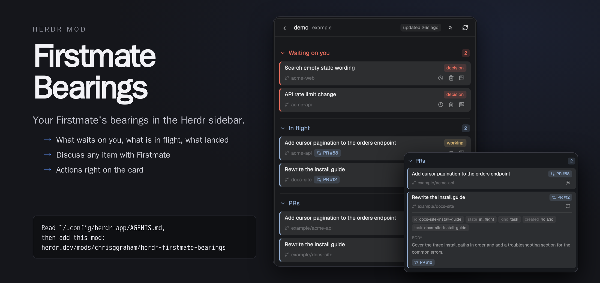

# Firstmate Bearings

Firstmate Bearings is a sidebar panel for the Herdr desktop app. It shows the bearings of a [Firstmate](https://github.com/kunchenguid/firstmate) that is open in any tab.



The panel sends notes to a Firstmate (Discuss) and runs actions (Done, Defer, Drop, Stop, Start now) through that Firstmate's inbox, with `bin/fm-inbox.sh note`.

## Features

- Home page that lists the Firstmates open in Herdr, on this computer and on connected machines, with an away indicator.
- Sections with counts: Waiting on you, In flight, PRs, Secondmates, Queued and Landed. Each one collapses. Empty sections are hidden.
- Two-line cards: the title with a status pill or PR chip, then the repo with the actions.
- Opened card: all badges, the description, long texts and link chips.
- Discuss: a dialog that sends a note about a card to the Firstmate.
- Actions on a card, only when valid: Done, Defer and Drop (Waiting on you), Stop (In flight), Start now (Queued). Drop and Stop ask first.
- Refresh button, and Collapse all or Expand all.
- Card details come from the full task record.
- Errors go to a log file.
- Demo mode: a built-in sample Firstmate with invented data, for screenshots.
- Settings in `config.json`.

## Install

The mod runs `bin/fm-bearings-snapshot.sh` from a Firstmate home on your machines. Install it only if you want that.

Paste this to your Herdr agent:

```
Read ~/.config/herdr-app/AGENTS.md,
then add this mod:
herdr.dev/mods/chrisggraham/herdr-firstmate-bearings
```

Or install it by hand:

1. Copy or link `mods/firstmate-bearings` into `~/.config/herdr-app/mods/`.
2. Add the **Firstmate** button and the panel block to your tab bar and layout. `RECIPE.md` has the exact edits.
3. Check the mod: `herdr-app check ~/.config/herdr-app/mods/firstmate-bearings`

## Use

1. Click **Firstmate** in the tab bar. The panel lists the Firstmates found in open tabs.
2. Pick one. The panel shows its bearings and refreshes every 30 seconds.
3. Click the back arrow at the top left to return to the list.

A Firstmate is found when one of its panes is open in its home folder. The pick is kept across restarts.

A card opens when you click its title. Card details are fetched once per task with `fm-tasks-axi.sh show <id> --full`. If a refresh fails, the last data stays with its age and one error line. While a Firstmate is in away mode, the panel says so and keeps the last data.

**Discuss** (the message icon) opens a multi-line note box. Cmd or Ctrl+Enter sends, Enter adds a line and Esc cancels. The note holds the section and the item id, never the card text. On success the dialog closes and the icon shows a check. A failure keeps the dialog open with the error.

An action button sends one note, `[bearings panel] <action> <section> <item id>`.

## Settings

`mods/firstmate-bearings/config.json` is read on every refresh.

```json
{ "hideEmptySections": true, "demo": false }
```

- `hideEmptySections` (default `true`): hide a section that has no items. Set it to `false` to show every section.
- `demo` (default `false`): show a built-in sample Firstmate instead of the real ones. See Demo mode.

## Demo mode

Demo mode shows invented data, so a screenshot never shows real projects. It is for taking a screenshot of the panel.

1. Set `"demo": true` in `mods/firstmate-bearings/config.json`. The panel picks it up within a few seconds.
2. The panel lists one Firstmate named `demo` on the host `example`. Open it: it has a few sample projects and tasks in every section.
3. Take the screenshot.
4. Set `"demo": false` again.

In demo mode the panel runs no command and writes no log line. The Discuss and action buttons look and work as usual, including the check after a send, but send nothing. Refresh only draws the sample data again. The sample data is in `mods/firstmate-bearings/demo.js`.

## Errors

Errors are logged with their time, place and a short message in `firstmate-bearings.log` in the Herdr app folder (`~/.config/herdr-app/`, or `$HERDR_APP_HOME`). The log keeps the newest 200 lines.

## Update

Pull this repo again. Herdr reloads the mod.

## Development

- `npm test` runs `node --test`.
- `herdr-app check mods/firstmate-bearings` checks the mod.
- `docs/design.md` describes the data contract, discovery and display. `docs/fields.md` lists the fields.
